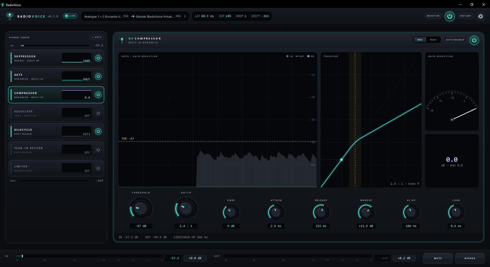

<h1 align="center">RadioVoice</h1>

<p align="center"><strong>Your mic. Your sound.</strong></p>
<p align="center">
  Real-time microphone processing for Windows.<br>
  Clean up the noise, shape your voice, and bring your own VST3 plugins.
</p>

<p align="center">
  <a href="https://github.com/doctorspider42/radio-voice/releases/latest"></a>
  <a href="https://github.com/doctorspider42/radio-voice/actions/workflows/release.yml"></a>
  
  
  <a href="LICENSE"></a>
</p>

<p align="center">
  <a href="https://github.com/doctorspider42/radio-voice/releases/latest"><strong>Download for Windows</strong></a>
  &nbsp;·&nbsp; <a href="QUICKSTART.md">Setup guide</a>
  &nbsp;·&nbsp; <a href="CHANGELOG.md">What's new</a>
  &nbsp;·&nbsp; <a href="https://github.com/doctorspider42/radio-voice/issues">Report a bug</a>
</p>



## A voice chain for every app

Process your microphone once, then send the result to **Discord, OBS, Teams**, or
any app that accepts a microphone through a virtual audio cable.

| | What you get |
| :--- | :--- |
| **Clean** | RNNoise neural noise suppression and a gate with lookahead. |
| **Shape** | Ten-band EQ, high- and low-pass filters, compressor, and output limiter. |
| **Make it yours** | Drag to reorder built-in effects and VST3 plugins. Open native plugin editors or use the parameter list. |
| **Keep it running** | Monitor through headphones, save your chain and plugin state, and hide the window to the tray while audio keeps flowing. |

## Get started

1. **Install RadioVoice** from the [latest release](https://github.com/doctorspider42/radio-voice/releases/latest).
2. **Route your audio.** With [VB-CABLE](https://vb-audio.com/Cable/) installed,
   choose your microphone as **Input** and `CABLE Input` as **Output** in RadioVoice.
3. **Pick `CABLE Output` as the microphone** in your receiving app. Adjust your
   chain; enable **Monitor** and select your headphones to hear the result.

> **Bundled driver:** The optional RadioVoice virtual cable is test-signed and
> requires Secure Boot off and Windows test signing on. VB-CABLE is the setup
> path above. Read the [driver guide](driver/README.md) before choosing the bundled driver.

Need the full walkthrough? See [QUICKSTART.md](QUICKSTART.md).

## Under the hood

**C++20 · Dear ImGui · Direct3D 11 · WASAPI / ASIO / DirectSound**

Native audio backends, a lock-free capture buffer, and clock-drift compensation
between input and output devices. No audio framework.

```text
Microphone → Your chain → Output limiter → Virtual cable → Your apps
```

The effects before the output limiter are reorderable. Settings and plugin state
live in `%APPDATA%\RadioVoice\config.json`; logs are in `radiovoice.log` alongside it.

### Build from source

Use **Windows x64, CMake 3.24+, Ninja, Git, and MinGW-w64 GCC 13+**.
The first build downloads dependencies.

```bat
build.cmd
```

Run `build\bin\RadioVoice.exe`. Build variants and packaging instructions are in
the [setup guide](QUICKSTART.md) and [installer guide](installer/README.md).

### Current limits

- **WASAPI shared mode is the tested path.** ASIO and WASAPI exclusive mode are
  implemented but not verified on hardware; DirectSound capture has known issues
  on some interfaces.
- **Neural noise suppression requires 48 kHz** and adds 10 ms of latency.
- **MinGW is the supported build toolchain.** MSVC builds have known dependency
  failures. The installer and bundled driver are not Microsoft-signed.

## License

**GPL-3.0-or-later.** See [LICENSE](LICENSE) and [third-party notices](NOTICE.md).
